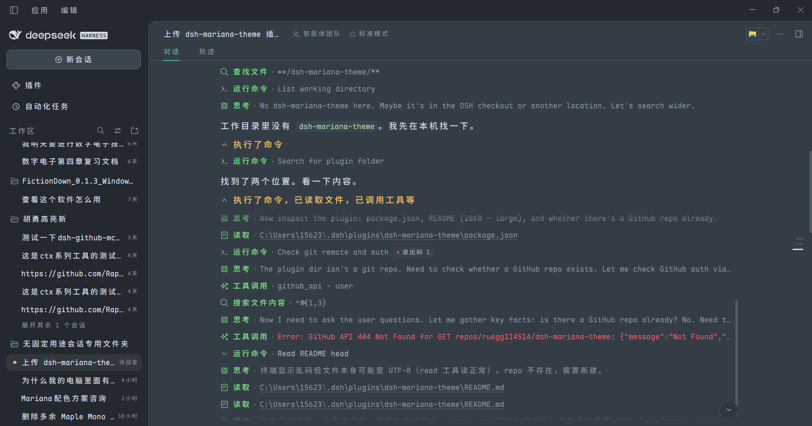
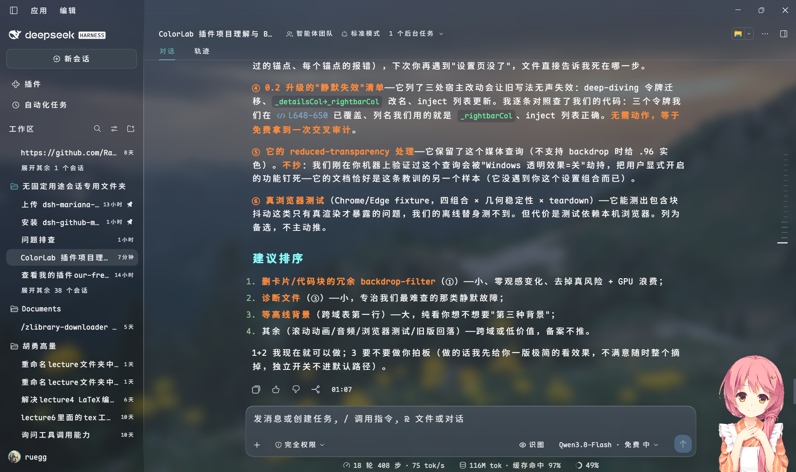

# dsh-colorlab

**EN** · [中文](#中文)

A colour theme plugin for the DeepSeek Harness chat UI. It ships Sublime Text's
**Mariana** palette as its default preset, and adds a colour engine on top: 18
adjustable colour slots, 9 Markdown prose roles, saved presets, live WCAG contrast
warnings and light/dark modes — all from a settings panel, persisted to your profile.



> Process rows are colour-coded (green for tool calls, amber for summaries),
> headings and inline code are tinted, and the surface sits on Mariana's
> cool blue-grey rather than pure black.

### Glass UI (opt-in)

With **Glass interface** on, the three columns become translucent panels over a
background layer — your Windows wallpaper, a generated gradient, or a procedural
topographic contour sheet. Blur is applied once, to the background itself, so
every surface sees the same frosted world underneath; each layer paints only the
*difference* between its tier and the one below, so cards stay legibly above the
columns and the columns stay tinted with the theme instead of washing out.



> Screenshot: glass on over a wallpaper; title bar, sidebar and conversation
> read as one continuous sheet of tinted glass; the composer card is lifted out
> of the scroll flow, so streamed text clips cleanly at its top edge instead of
> sliding underneath.

It does not patch `app.asar`, and it does not fork the host. It uses DSH's
official theme extension point (`ctx.theme.overrideTokens`) and layers its tokens
on top of whatever theme is active.

---

## Install

```sh
dsh plugin add ruegg114514/dsh-colorlab
```

This installs from source, so DSH will ask you to approve the package's build
step (`allowBuilds`) on first run. Restart DSH afterwards — the plugin is picked
up by the loader at boot.

## Uninstall

```sh
dsh plugin remove ruegg114514/dsh-colorlab
```

Or just turn **Enable** off in the plugin's settings panel: the theme reverts to
the host default immediately, no restart needed, and your saved colours are kept.

---

## What it changes

Mariana is the default colour scheme of Sublime Text 3.0 (2017) and Sublime
Text 4. Its background is a cool blue-grey (`#343D46`) rather than pure black,
and its foreground is a soft grey (`#D8DEE9`) rather than pure white — which is
why it stays readable for long sessions on bright displays.

| Area | Effect |
|---|---|
| Surfaces / cards / sidebar / menus | `#343D46` / `#2F3841` / `#23292E` |
| Body / secondary / tertiary text | `#D8DEE9` / `#A7ADBA` / `#8792A2` |
| Borders and dividers | low-opacity overlays of `#D8DEE9` |
| Bubbles / input / code blocks | `#3B454F` / `#2E363F` |
| Status colours | success `#99C794`, error `#EC5F67`, warning `#F9AE58` |
| Code syntax highlighting | keywords `#C594C5`, strings `#99C794`, functions `#5FB3B3`, numbers `#F9AE58`, comments `#8792A2` |
| Sidebar terminal | background and cursor follow the theme |

## The colour engine

### Settings panel

Settings → **ColorLab**:

| Option | What it does |
|---|---|
| **Enable** | Off reverts to the host palette immediately; your settings are kept |
| **Apply to** | Dark appearance only (default) / both dark and light |
| **Surface variant** | Standard `#343D46` / Deep `#252B32` (the early ST3 tmTheme) / Dim `#2B3336` |
| **Accent** | Teal `#5FB3B3` / Orange `#F9AE58` / Blue `#6699CC` — affects business-state highlights only |
| **Code palette** | Overrides Shiki's `--shiki-*` tokens used inside fenced code blocks |
| **Prose highlight** | Adds colour hierarchy to Markdown body text (headings, bold, inline code, list markers, quote rules) |
| **Prose brightness** | Original / Boosted (default) / Brighter — interpolates toward white without shifting hue |
| **Prose preview** | Shows both states side by side, right under the toggle |
| **Prose colours** | 9 independent slots: heading, bold, italic, inline code, list marker, quote text, quote rule, link, strikethrough |
| **Process row highlight** | Colours process rows — tool rows one colour, summary rows another |
| **File card colour** | Recolours the header band of "edited N files" cards and the whole card body of "delivered files" cards |
| **Custom colours** | 18 slots (8 surfaces / 3 text / 7 syntax), each adjustable |
| **Presets** | Save the current palette and load it back later, up to 12 |
| **Glass interface** | Translucent panels over a background layer (off by default) |
| **Background source** | Windows wallpaper / generated gradient / procedural **contour** lines (ported from dsh-theme-endfield, MIT) |
| **Surface tint** | Column opacity 0–100 (65 default; lower = wallpaper shows through more) |
| **Float tint** | How much more solid cards/menus/input sit above the columns (0–40) |
| **Blur radius** | Background pre-blur 0–40 px |
| **Advanced (fold)** | Background dimming (auto/fixed/off), saturation 0–200%, haze, custom wallpaper path |
| **Contour speed** | static / 1x / 2x / 4x; renders in a Web Worker when CSP allows, with a visible backend note |
| **Hand-drawn shape** | Uneven corner radii, paper shadows, hover lift and a glowing sidebar divider (off by default; mechanism borrowed from dsh-maid-whale-UI, no art assets) |

**LaTeX gets a dedicated highlighter.** Sublime's own
`LaTeX.sublime-syntax` + `TeX.sublime-syntax` are ported wholesale and run
through a small TextMate engine, then coloured with the rules from
`Mariana.sublime-color-scheme` — so LaTeX matches Sublime character for
character rather than approximately: the backslash is teal on its own, every
brace is teal (including after user macros like `\zh{`), math builtins are
purple while custom macros are blue, digits orange, `=` `+` `-` orange-red,
identifiers white italic. See `docs/DESIGN.md` for why guessing at Shiki's
tokens could never get there.

Everything else keeps Shiki's tokens. Python built-ins (`print`, `len`,
`open`) get Mariana's `var(blue)` (`#6699CC`) — the colour Sublime gives
`support.function`. Shiki merges that scope with `entity.name.function` into a
single token, so function *calls* match Sublime while function *definition
names* are blue there too.

Markdown gets Sublime's `markup.*` details: list markers in `var(green)`,
blockquote text in `var(orange)`, and inline code on a tinted background.

### 18 custom colour slots

| Group | Slots |
|---|---|
| Surfaces (8) | base, panel 1/2/3, overlay menu, sidebar, code block, bubble/input |
| Text (3) | body, secondary, tertiary |
| Syntax (7) | strings, functions/punctuation, links/calls, keywords, errors/constants, numbers/cursor, find highlight |

Three ways to change a slot: click the swatch to open the system colour picker,
type a hex value below it, or paste one in.

**Resetting to default clears that override** — only the slots that actually
differ from the default are written to your profile, so clicking around a bit
does not pin all 18 down.

**Live contrast warning**: when body text against the background drops below
4.5:1, the settings panel reports the measured ratio and suggests ≥ 7:1. The
figure is computed as real WCAG contrast, not estimated.

### Presets

Name it and press Save to store the current surface variant, accent and all
custom slots. Each preset shows five swatches (surface / body / accent /
keyword / string) so you can tell them apart at a glance.

- Saving under an existing name overwrites it
- 12 presets maximum — they live in your profile's YAML
- Each carries a timestamp ("just now / N min ago / MM-DD HH:mm")
- A preset matching your current palette is marked *in use*
- **Resetting to defaults does not delete your presets** — they're your own
  work; reset only touches the live palette

### Three independent highlight toggles

| Toggle | Scope | Mechanism |
|---|---|---|
| **Code palette** | Fenced code blocks only | Overrides `--shiki-*`, consumed by Shiki's inline `<span>` styles |
| **Prose highlight** | Markdown body text only | Injects a stylesheet targeting the host's markdown container |
| **Process row highlight** | Process entries (write / edit / run command) only | Injects a stylesheet targeting `data-variant` rows |

Turning one off does not affect the others.

### Prose brightness

| Role | Original | Boosted (default) | Brighter |
|---|---|---|---|
| Heading | `#5FB3C3` 4.51:1 | `#7CC1C1` 5.39:1 | `#92CBCB` 6.11:1 |
| Bold | `#F9AE58` 5.90:1 | `#FABD76` 6.63:1 | `#FBC88D` 7.23:1 |
| Italic / quote | `#A7ADBA` 4.91:1 | `#B7BCC6` 5.80:1 | `#C3C7D0` 6.52:1 |
| Inline code | `#99C794` 5.76:1 | `#ABD1A7` 6.52:1 | `#BAD9B6` 7.20:1 |
| Link | `#80AAD5` 4.54:1 | `#97B9DD` 5.42:1 | `#A9C5E2` 6.19:1 |
| Strikethrough | `#EC5F67` 3.36:1 | `#EF7C82` 4.14:1 | `#F29298` 4.91:1 |

(Contrast measured against `#343D46`; darker surface variants score higher.)

Only dark values are brightened — on the light appearance, interpolating toward
white would *reduce* contrast. Code blocks and interface surfaces are never
affected.

### Process row highlight

Two colours, three targets. Summary and expanded content stay unchanged.

| Target | Example | Default |
|---|---|---|
| Tool rows | write / edit / run command | Light green `#7EE787` |
| Summary rows | ran a command, wrote files, analysing your request | Light amber `#FAC863` |
| Turn summary | "Done, took 1m 20s" | Light amber `#FAC863` |

10 categories are selectable (grouped into summary rows and tool rows), 5
enabled by default. Both colours are independently adjustable.

### A diagnostic line that stays hidden until something breaks

The settings panel used to carry a row of status chips (channel / token count /
prose / appearance / config). Healthy state is noise, so it is gone: the panel
shows **nothing** when everything works, and a single plain-language warning
line when it does not — fell back to the style channel, config not writable
("changes last this session only"), glass layer failed to mount. Startup
transients never flash yellow.

Low-frequency controls now live behind `<details>` folds (prose preview + 9
slots, glass "advanced", the full 18-slot palette), each fold summarising its
state in the header, e.g. "customised 3 of 18".

> **The settings panel itself is currently in Chinese only.** The theme, the
> preset names you type and everything else are language-independent.

---

## Known limitations

- **Terminal ANSI 16 colours are not themed.** The host does not expose the
  xterm ANSI palette as design tokens and the plugin cannot reach the xterm
  instance, so only the terminal background, foreground, cursor and selection
  follow the theme.
- **Prose highlighting depends on a host class-name prefix.** It matches
  `[class*="_markdown_"]`; the prefix comes from a host source filename and is
  stable across builds, but if the host **renames that CSS Module file** the
  rule stops matching — prose falls back to a single colour, without an error.
- **Prose highlighting does not cover half-parsed Markdown.** During streaming
  the DOM structure is the same so rules still apply, but an unclosed `**` is
  not coloured while it is half-written.
- **Corner radii are untouched by default.** Fonts stay with `dsh-font-probe`.
  The optional **Hand-drawn shape** toggle does restyle corner radii and
  shadows — deliberately off by default, and it only ever touches named
  surfaces (input card, dialogs, menus, code blocks, detected cards), never
  a full-tree scan.
- **The light variant is not original Mariana.** Mariana itself is dark-only;
  the light values are same-hue lightened derivatives, there so that
  "apply to both" mode is not glaring.
- **Custom colours only override the dark appearance.** There are no custom
  slots for light — deliberately, so colours picked against a dark background
  do not become invisible on a light one.
- **Presets live as a YAML string in your profile.** The 12-preset cap keeps
  this bounded. If you hand-edit `cordis.patch.yml` and break the `presets`
  field, the plugin safely treats it as "no presets" — nothing throws and
  nothing is lost, the presets just stop showing until you fix the YAML.

---

## Design notes

Implementation details — how the token override works, why the two channels
exist, how host CSS specificity was matched rule by rule, how a write-race
condition was found and fixed — are kept in [docs/DESIGN.md](docs/DESIGN.md)
(in Chinese).

## Tests

```sh
npm test        # 14 suites, offline
npm run check   # syntax check
```

## License

MIT. The Mariana palette originates from Sublime Text
(`Sublime HQ Pty Ltd`, colour scheme by Dmitri Voronianski). This plugin is an
independent reimplementation of the palette as DSH design tokens; it is not
affiliated with or endorsed by Sublime HQ.

The optional contour background is ported from
[dsh-theme-endfield](https://github.com/ymh0000123/dsh-theme-endfield)
(MIT, (c) yunxiiQwQ) — core pipeline only (field → marching squares → stitch →
smooth → draw), with its own comments and measured constants preserved; none of
that project's art assets are included.

---

<a name="中文"></a>

# 中文

DeepSeek Harness 对话界面的配色主题插件。内置 Sublime Text 的 **Mariana**
配色作为默认预设，并在其上提供一套配色引擎：18 个可调颜色槽位、9 个正文
Markdown 角色色、配色方案存取、实时 WCAG 对比度提示、深浅两种模式 ——
全部在设置页里完成，配置持久化到 profile。


> 过程条目按类型上色（工具行亮绿、汇总行亮黄），标题与行内代码着色，
> 界面底色是 Mariana 的冷调蓝灰而不是纯黑。

### 玻璃界面（可选）

打开「玻璃界面」后，三列变成盖在背景层上的半透明面板 —— 背景可以是
Windows 桌面壁纸、程序生成的渐变光斑、或**等高线**（移植自
dsh-theme-endfield 的地形线）。模糊只做一次、做在背景层自己身上，
所以所有面板"看到"的是同一张糊好的底；每一层只涂自己档位与下层之间的
**差值**，卡片永远比正文列实一档，列永远保住主题色而不是被冲淡。


> 截图：开玻璃 + 壁纸背景。侧栏、会话区、右栏读起来是一整张 tinted 玻璃；
> 输入卡被硬裁在滚动内容之上，正文不会从卡片底下穿帮。

它不改 `app.asar`，不补包，不 fork 宿主 —— 它走 DSH 官方的主题扩展点
（`ctx.theme.overrideTokens`），把令牌叠加在当前主题之上。

## 安装

```sh
dsh plugin add ruegg114514/dsh-colorlab
```

从源码安装，首次运行 DSH 会要求你授权该包的构建步骤（`allowBuilds`）。
装完重启 DSH —— loader 在启动时装载插件。

## 卸载

```sh
dsh plugin remove ruegg114514/dsh-colorlab
```

或者直接在设置页把「启用」关掉：立即回退到宿主默认配色，无需重启，
已保存的颜色不会丢。

## 它改了什么

Mariana 是 Sublime Text 3.0（2017）起及 Sublime Text 4 的默认配色，
底色是冷调蓝灰 `#343D46` 而不是纯黑，前景是柔和的灰 `#D8DEE9` 而不是纯白 ——
长时间用下来没那么刺眼。

| 位置 | 效果 |
|---|---|
| 界面底色 / 卡片 / 侧栏 / 菜单 | `#343D46` / `#2F3841` / `#23292E` |
| 正文 / 次级 / 三级文字 | `#D8DEE9` / `#A7ADBA` / `#8792A2` |
| 边框与分隔线 | `#D8DEE9` 的低透明叠加 |
| 气泡 / 输入 / 代码块 | `#3B454F` / `#2E363F` |
| 状态色 | 成功 `#99C794`、错误 `#EC5F67`、警告 `#F9AE58` |
| 代码语法高亮 | 关键字 `#C594C5`、字符串 `#99C794`、函数 `#5FB3B3`、数字 `#F9AE58`、注释 `#8792A2` |
| 侧栏终端 | 底色与光标跟随主题 |

## 设置页

设置 → **ColorLab**：

| 项 | 说明 |
|---|---|
| **启用** | 关掉立即回退宿主配色，设置保留 |
| **套用范围** | 「仅深色外观」（默认）/「深浅都套用」 |
| **背景变体** | 标准 `#343D46` / 深 `#252B32`（ST3 早期 tmTheme 那档）/ 中间 `#2B3336` |
| **强调色** | 青 `#5FB3B3` / 橙 `#F9AE58` / 蓝 `#6699CC`，只影响业务态高亮 |
| **代码高亮色板** | 覆盖代码块内 Shiki 的 `--shiki-*` 色板 |
| **正文高亮** | 给 Markdown 正文加颜色层次（标题、加粗、行内代码、列表标记、引用竖线） |
| **正文高亮亮度** | 原值 / 提亮（默认）/ 更亮。在原色基础上朝白插值，色相不动 |
| **正文高亮预览** | 紧跟开关，直接展示开/关两种效果 |
| **正文颜色** | 9 个独立槽位：标题、加粗、斜体、行内代码、列表标记、引用文字、引用竖线、链接、删除线 |
| **过程行高亮** | 工具行一个颜色、汇总行另一个颜色 |
| **文件卡片颜色** | 「已编辑 N 个文件」卡片的头部横带，以及「交付文件」卡片的整张底色 |
| **自定义配色** | 18 个槽位（界面底色 8 / 文字 3 / 语法色 7），逐个调 |
| **配色方案** | 把当前配色存成方案，随时载入，最多 12 套 |
| **玻璃界面** | 三列变半透明面板，透出背景层（默认关） |
| **背景来源** | 桌面壁纸（跟随 Windows 当前壁纸）/ 渐变（配色派生光斑）/ **等高线**（程序生成的地形线，移植自 dsh-theme-endfield，MIT） |
| **表面浓度** | 三列透明度 0–100（默认 65；越低壁纸越明显，主题色越淡） |
| **浮层浓度** | 卡片/菜单/输入框比底板"实"多少（0–40） |
| **模糊半径** | 背景层预模糊 0–40px |
| **高级（折叠）** | 背景压暗（自动/固定档/关）、饱和度 0–200%、白雾、自选壁纸路径 |
| **等高线速度** | 静止 / 1x / 2x / 4x；能起 Web Worker 时在主线程外渲染，设置页副标题会显示实际后端 |
| **手绘造型** | 四角不等宽的圆角（手绘感）、纸片式双层投影、悬停微抬、侧栏右缘渐隐发光线。默认关，与玻璃界面互相独立（机制借鉴 dsh-maid-whale-UI，不含其美术） |

**LaTeX 走专门的高亮通道。** 直接把 Sublime 的 `LaTeX.sublime-syntax` 与
`TeX.sublime-syntax` **整份移植**过来，用一个小型 TextMate 引擎跑分词，
再套 `Mariana.sublime-color-scheme` 的规则上色 —— 所以 LaTeX 是**逐字符**
对齐 Sublime，而不是"近似"：反斜杠单独是青色、**所有**花括号都是青色
（`\zh{` 这类自定义宏后面也是）、数学内置命令紫而自定义宏蓝、数字橙、
`=` `+` `-` 橙红、标识符白斜体。为什么"猜 Shiki 的令牌"永远到不了这一步，
见 `docs/DESIGN.md`。

其余语言仍走 Shiki 的令牌。Python 内置函数（`print` `len` `open`）用 Mariana 的
`var(blue)`（`#6699CC`），与 Sublime 里 `support.function` 的颜色一致 ——
Shiki 把 `support.function` 和 `entity.name.function` 合并成同一个令牌，
所以函数**调用**与 Sublime 一致，函数**定义名**则也是蓝色。

Markdown 会补上 Sublime 的 `markup.*` 细节：列表符号 `var(green)` 绿、
引用正文 `var(orange)` 橙、行内代码加淡色底。

### 18 个自定义槽位

| 分组 | 槽位 |
|---|---|
| 界面底色（8） | 主背景、面板一/二/三层、浮层菜单、侧栏、代码块、气泡输入框 |
| 文字（3） | 正文、次级文字、三级文字 |
| 语法色（7） | 字符串、函数/标点、链接/调用、关键字、错误/常量、数字/光标、查找高亮 |

三种改法：点色块开系统取色面板、在下面直接输 hex、或粘贴色值。

**改回默认会自动清除该覆盖** —— 存进 profile 的只有「偏离默认」的那几项，
不会因为点过一圈就把 18 项全写进去。

**实时对比度提示**：正文与背景的对比度掉到 4.5:1 以下时，设置页会提示
「正文与背景对比度只有 x.xx:1（建议 ≥ 7:1），可能看不清」。这个数字是当场算的
WCAG 对比度，不是估算。

### 配色方案

输入名字点「保存」，就把当前背景变体 + 强调色 + 全部自定义槽位存成一套。
列表里每套显示 5 个色点（背景/正文/强调/关键字/字符串）方便辨认。

- 同名保存 = 覆盖
- 上限 12 套（存在 profile 的 YAML 里）
- 每套带保存时间：「刚刚 / N 分钟前 / MM-DD HH:mm」
- 与当前配色一致的方案显示「使用中」
- **「恢复默认配色」不会删掉已保存的方案** —— 那是你的资产

### 三个高亮开关互不影响

| 开关 | 范围 | 机制 |
|---|---|---|
| **代码高亮色板** | 只有围栏代码块 | 覆盖 `--shiki-*` |
| **正文高亮** | 只有 Markdown 正文 | 注入样式表，命中宿主 markdown 容器 |
| **过程行高亮** | 只有过程条目 | 注入样式表，命中 `data-variant` 行 |

### 正文高亮亮度

| 角色 | 原值 | 提亮（默认） | 更亮 |
|---|---|---|---|
| 标题 | `#5FB3C3` 4.51:1 | `#7CC1C1` 5.39:1 | `#92CBCB` 6.11:1 |
| 加粗 | `#F9AE58` 5.90:1 | `#FABD76` 6.63:1 | `#FBC88D` 7.23:1 |
| 斜体 / 引用 | `#A7ADBA` 4.91:1 | `#B7BCC6` 5.80:1 | `#C3C7D0` 6.52:1 |
| 行内代码 | `#99C794` 5.76:1 | `#ABD1A7` 6.52:1 | `#BAD9B6` 7.20:1 |
| 链接 | `#80AAD5` 4.54:1 | `#97B9DD` 5.42:1 | `#A9C5E2` 6.19:1 |
| 删除线 | `#EC5F67` 3.36:1 | `#EF7C82` 4.14:1 | `#F29298` 4.91:1 |

（对比度在 `#343D46` 上算；背景越暗数字越高。）

只提亮深色值 —— 浅色外观是深字浅底，朝白插值会*降低*对比度。
代码块与界面底色完全不受影响。

### 过程行高亮

两种颜色、三类目标，摘要与展开内容不变。

| 目标 | 例子 | 默认色 |
|---|---|---|
| 工具行 | 写入 / 编辑 / 运行命令 | 亮绿 `#7EE787` |
| 汇总行 | 执行了命令、已写入文件 / 正在分析请求 | 亮黄 `#FAC863` |
| 本轮汇总 | 已完成，用时 1 分 20 秒 | 亮黄 `#FAC863` |

10 个分类可勾选（分「汇总行」「工具行」两组），默认选中 5 项。
两个颜色各自独立可调。

### 一条只在出事时才出现的诊断行

设置页顶部原来有一排状态芯片（通道/令牌数/正文/外观/配置）——健康状态下
那是纯噪音，已经退役。现在一切正常时**什么都不显示**；真出事才出现一行
人话（"回退到样式表通道"、"改动只在本次会话生效"、"背景层未建立"），
启动瞬态不会闪黄字。

低频控件收进了 `<details>` 折叠块（正文预览+9 槽、玻璃「高级」、完整
18 槽调色板），折叠标题右侧带状态摘要，比如「已自定义 3 个」。

> **设置页文案目前只有中文。** 主题本身、配色方案名称等与语言无关。

## 已知限制

- **终端 ANSI 16 色不变。** 宿主没有把 xterm 的 ANSI 调色板暴露成设计令牌，
  插件也拿不到 xterm 实例，只能保证底色 / 前景 / 光标 / 选区跟随主题。
- **正文高亮的选择器依赖宿主类名前缀。** 用 `[class*="_markdown_"]` 匹配，
  前缀来自宿主源文件名，跨构建稳定；但宿主若**重命名那个 CSS Module 文件**，
  规则会失配 —— 表现是正文退回同色，不会报错。
- **正文高亮不覆盖流式渲染中的半截 Markdown。** DOM 结构相同所以规则照常命中，
  但未闭合的 `**` 在半截状态下不会被着色。
- **默认不改圆角与字体。** 字体是 `dsh-font-probe` 的职责；可选的「手绘造型」
  开关会改圆角与投影 —— 刻意默认关，且只点名已知表面（输入卡/对话框/菜单/
  代码块/检测到的卡片），不做全树扫描。
- **浅色变体不是 Mariana 原版。** Mariana 本身只有深色版，浅色值是同色相提亮的
  自制品，只为「深浅都套用」模式下不刺眼。
- **自定义配色只覆盖深色。** 浅色没有对应槽位 —— 刻意的，避免把深色下挑的颜色
  搬到浅色底上变成看不见的字。
- **配色方案存在 profile 的 YAML 字符串里。** 12 套上限是为了不让它无限膨胀。
  如果手改 `cordis.patch.yml` 把 `presets` 写坏，插件会安全地当成「没有方案」，
  不抛错也不丢数据，只是界面上看不到 —— 修好 YAML 即可恢复。

## 实现说明

实现细节 —— 令牌覆盖的原理、两条通道的存在理由、宿主 CSS 特异性的逐条对齐、
一个写盘竞态的发现与修复 —— 放在 [docs/DESIGN.md](docs/DESIGN.md)。

## 校验

```sh
npm test        # 14 个套件，离线可跑
npm run check   # 语法检查
```

## 许可

MIT。Mariana 配色来自 Sublime Text（`Sublime HQ Pty Ltd`，配色方案作者
Dmitri Voronianski）。本插件是把该配色重新实现为 DSH 设计令牌的独立实现，
与 Sublime HQ 无隶属或背书关系。

可选的「等高线」背景移植自
[dsh-theme-endfield](https://github.com/ymh0000123/dsh-theme-endfield)
（MIT，(c) yunxiiQwQ）：只取核心管线（场 → marching squares → 缝合 → 平滑 →
描边），保留了它的注释与实测常数；不含该项目的任何美术素材。
