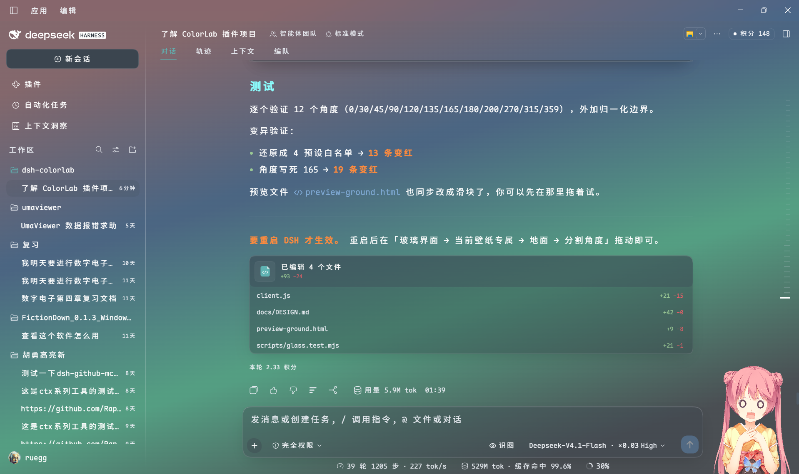
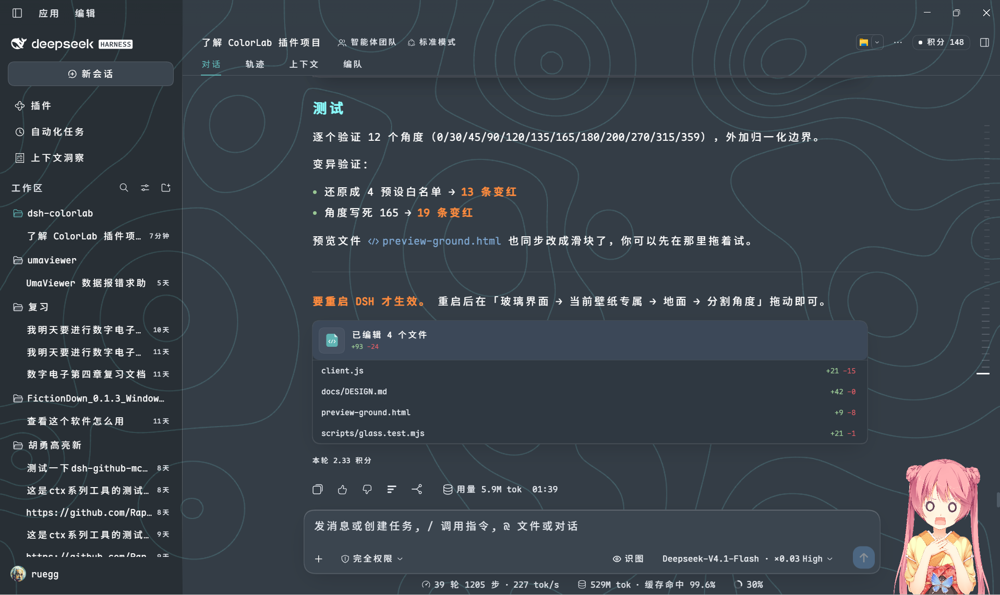

# dsh-colorlab

**EN** · [中文](#中文)

A colour theme plugin for the DeepSeek Harness chat UI. It ships Sublime Text's
**Mariana** palette as its default preset, and adds a colour engine on top: 18
adjustable colour slots, 9 Markdown prose roles, saved presets, live WCAG contrast
warnings and light/dark modes — all from a settings panel, persisted to your profile.


> Process rows are colour-coded (green for tool calls, amber for summaries),
> headings and inline code are tinted, and the surface sits on Mariana's
> cool blue-grey rather than pure black.

### Glass UI (opt-in)

With **Glass interface** on, the three columns become translucent panels over a
background layer — your Windows wallpaper, a generated gradient, or a procedural
topographic contour sheet. Blur is applied once, to the background itself, so
every surface sees the same frosted world underneath; each layer paints only the
*difference* between its tier and the one below, so cards stay legibly above the
columns and the columns stay tinted with the theme instead of washing out.


> Screenshot: glass on over a wallpaper; title bar, sidebar and conversation
> read as one continuous sheet of tinted glass; the composer card is lifted out
> of the scroll flow, so streamed text clips cleanly at its top edge instead of
> sliding underneath.

### Background ground: glow / bands / blend

The generated-gradient background is a small compositor of its own. Pick **glow**
(soft coloured fog, no edges), **bands** (angular colour strips) or **blend**
(both), then colour every element yourself:

- **Glow** — 2–6 light sources, each with its own colour, strength and X/Y
  position, plus overall density (0–100%) and spread (40–140%).
- **Bands** — 2–6 strips, each its own colour, plus a cutting angle anywhere
  from 0° to 360° and an edge-softness slider (0 = hard cut).



> Screenshot: the generated gradient background in glow mode — several soft
> coloured lights composited over the theme base, no wallpaper involved.

### Contour background

The third background source is procedural: a topographic contour sheet rendered
in a worker thread. Speed, ink density, line width, terrain density, elevation
steps, drift amplitude and optional elevation labels are all adjustable, and the
whole thing costs nothing when the speed is set to **still** (one frame, then no
repaint).



> Screenshot: contour mode. Terrain lines are tinted from the accent colour and
> the panels stay translucent above them.


It does not patch `app.asar`, and it does not fork the host. It uses DSH's
official theme extension point (`ctx.theme.overrideTokens`) and layers its tokens
on top of whatever theme is active.

---

## Install

```sh
dsh plugin add ruegg114514/dsh-colorlab
```

This installs from source, so DSH will ask you to approve the package's build
step (`allowBuilds`) on first run. Restart DSH afterwards — the plugin is picked
up by the loader at boot.

## Uninstall

```sh
dsh plugin remove ruegg114514/dsh-colorlab
```

Or just turn **Enable** off in the plugin's settings panel: the theme reverts to
the host default immediately, no restart needed, and your saved colours are kept.

## Versions

Releases are tagged and documented on the
[releases page](https://github.com/ruegg114514/dsh-colorlab/releases); the
per-version detail lives in [CHANGELOG.md](CHANGELOG.md).

The command above always installs the tip of `main`. To pin a specific release:

```sh
dsh plugin add ruegg114514/dsh-colorlab#v1.1.0
```

Version numbers follow [SemVer](https://semver.org/). While the plugin is
pre-2.0, a minor bump may still change how a setting looks — the CHANGELOG says
so explicitly under **Changed** when it does.

---

## What it changes

Mariana is the default colour scheme of Sublime Text 3.0 (2017) and Sublime
Text 4. Its background is a cool blue-grey (`#343D46`) rather than pure black,
and its foreground is a soft grey (`#D8DEE9`) rather than pure white — which is
why it stays readable for long sessions on bright displays.

| Area | Effect |
|---|---|
| Surfaces / cards / sidebar / menus | `#343D46` / `#2F3841` / `#23292E` |
| Body / secondary / tertiary text | `#D8DEE9` / `#A7ADBA` / `#8792A2` |
| Borders and dividers | low-opacity overlays of `#D8DEE9` |
| Bubbles / input / code blocks | `#3B454F` / `#2E363F` |
| Status colours | success `#99C794`, error `#EC5F67`, warning `#F9AE58` |
| Code syntax highlighting | keywords `#C594C5`, strings `#99C794`, functions `#5FB3B3`, numbers `#F9AE58`, comments `#8792A2` |
| Sidebar terminal | background and cursor follow the theme |

## The colour engine

### Settings panel

Settings → **ColorLab**:

| Option | What it does |
|---|---|
| **Enable** | Off reverts to the host palette immediately; your settings are kept |
| **Apply to** | Dark appearance only (default) / both dark and light |
| **Surface variant** | Standard `#343D46` / Deep `#252B32` (the early ST3 tmTheme) / Dim `#2B3336` |
| **Accent** | Teal `#5FB3B3` / Orange `#F9AE58` / Blue `#6699CC` — affects business-state highlights only |
| **Custom accent** | Any `#RRGGBB` via colour picker, hex input or random; overrides the presets. Light mode auto-darkens for contrast |
| **Code palette** | Overrides Shiki's `--shiki-*` tokens used inside fenced code blocks |
| **Prose highlight** | Adds colour hierarchy to Markdown body text (headings, bold, inline code, list markers, quote rules) |
| **Prose brightness** | Original / Boosted (default) / Brighter — interpolates toward white without shifting hue |
| **Prose preview** | Shows both states side by side, right under the toggle |
| **Prose colours** | 9 independent slots: heading, bold, italic, inline code, list marker, quote text, quote rule, link, strikethrough |
| **Process row highlight** | Colours process rows — tool rows one colour, summary rows another |
| **File card colour** | Recolours the header band of "edited N files" cards and the whole card body of "delivered files" cards |
| **Custom colours** | 18 slots (8 surfaces / 3 text / 7 syntax), each adjustable |
| **Presets** | Save the current palette and load it back later, up to 12 |
| **Glass interface** | Translucent panels over a background layer (off by default) |
| **Background source** | Windows wallpaper / **image URL** / generated gradient / procedural **contour** lines (ported from dsh-theme-endfield, MIT) |
| **Surface tint** | Column opacity 0–100 (65 default; lower = wallpaper shows through more) |
| **Float tint** | How much more solid cards/menus/input sit above the columns (0–40) |
| **Blur radius** | Background pre-blur 0–80 px |
| **Tier tint (fold)** | Three independent "how much more solid than the columns" knobs: float +0–40, code block +0–40, hover +0–20 |
| **Region tiers (fold)** | Sidebar / panel / preview / composer opacity (0–100) and overlay blur (0–80 px), each independently or "follow" |
| **Ambient palette** | Aurora / Ocean / Sunset / Mono, or follow the surface colours (gradient background only) |
| **Background brightness** | 0–100, 50 = neutral. Left darkens, right brightens; the ground fades out as it leaves neutral |
| **Ground (fold)** | Glow / Bands / Blend mode. Glow: 2–6 light sources, each with its own colour, strength and X/Y position; overall density 0–100%. Bands: 2–6 colour strips, each its own colour, plus direction (165°/135°/90°/0°) and edge softness |
| **Solid floats** | Pin history-message and hover-preview popovers to opaque (off by default) |
| **Solid diff** | Pin diff line backgrounds to opaque — line colours only, cards untouched (off by default) |
| **Background fit** | Fill / Fit / Stretch / Tile / Center / **Blur fill** — same names as Windows personalisation |
| **Crop & text guard (fold)** | Crop the wallpaper by ratio (left/top/width/height) + text guard (halo, no background tint) |
| **Auto tone** | Follow the wallpaper's average brightness to switch light/dark theme |
| **Advanced (fold)** | Background dimming (auto/fixed/off), saturation 0–200%, haze, custom wallpaper path, **image URL** |
| **Contour speed** | static / 1x / 2x / 4x; renders in a Web Worker when CSP allows, with a visible backend note |
| **Hand-drawn shape** | Uneven corner radii, paper shadows, hover lift and a glowing sidebar divider (off by default; mechanism borrowed from dsh-maid-whale-UI, no art assets) |

### Tier tint: three readability budgets instead of one

Glass has two very different jobs. The columns are **decoration** — they can be
as transparent as you like. Cards, code blocks and file previews are where you
**read**, and they need a separate budget: pull the surface tint down to see
your wallpaper and your code should still be legible.

Before, those three levels were hard-coded constants (`0.10 / 0.14 / 0.05`).
Now they are sliders, and the layering algorithm is unchanged: each layer paints
only the *difference* between its tier and the one below, so every position on
screen converges on its target instead of compounding
(`1-(1-a)²` is what you get from naive stacking — at 20% that reads as 36%).

| Knob | Range | Default | What it moves |
|---|---|---|---|
| **Float tint** | 0–40 | 10 | Cards, bubbles, composer, menus |
| **Code block tint** | 0–40 | 14 | Fenced code — read character by character, so it stays the most solid |
| **Hover tint** | 0–20 | 5 | Hover feedback; active state is 1.8× this |

### Region tiers: the same idea, one level down

Tier tint asks *how far above the columns* a layer sits. Region tiers ask a
different question: **does this piece of UI need to be read?**

Pull the surface tint down to admire your wallpaper and the file diff, the
stats popover and the composer all fade with it. Raise the surface tint to read
them and the whole interface goes solid. The two needs fight, so these four get
their own values:

| Setting | Range | Default | Covers |
|---|---|---|---|
| **Panel opacity** | 0-100 | *follow* | Popovers, menus, modals, stats and cost panels |
| **Preview opacity** | 0-100 | *follow* | File diffs, edited-files card, document preview |
| **Overlay blur** | 0-80 px | *follow* | Behind popovers, menus, modals |
| **Composer opacity** | 0-100 | *follow* | Composer, approval cards, task cards |

**"Follow" (-1) is the default for all four**, so upgrading changes nothing
until you open the fold and set one. Previously overlay blur was derived as
glassBlur + 10 and could not be adjusted.

> **Composer is opacity here, not blur** - deliberately different from the
> reference plugin. We do *seat lift* (see DESIGN.md): the composer is hoisted
> out of the scroll flow so content physically clips at its top edge. Nothing
> live sits behind it, so a backdrop-filter there would only buy the
> containing-block side effect (fixed-positioned tooltips drifting) with zero
> visual gain. That filter was removed on purpose on 2026-10-22, and a test
> now locks it out.

### Ambient palette

`glassAmbientAccent` picks the colour family of the gradient backdrop -
Aurora / Ocean / Sunset / Mono, or *follow the surface colours* (default).
It is separate from **Accent**, which drives buttons, links and status
highlights: you can keep a Mariana-teal interface over a sunset backdrop.
Only applies when the background source is *gradient* - a photo or contour
sheet has no ambient light to tint.

### Wallpaper fit and crop


`background-size: cover` was hard-coded. It is now five options matching
Windows' own wallpaper settings — Fill, Fit, Stretch, Tile, Center. Tile matters:
a 512 px texture wallpaper under `cover` gets blown up 8× on a 4K display.

Crop is expressed as **ratios, not pixels** (`{x, y, w, h}`, whole image =
`0,0,1,1`), so changing resolution or window size never needs a recompute.
Out-of-bounds boxes keep their width/height and push the top-left corner back
instead of squashing — the box stops at the edge, like a desktop crop tool.
The crop is a **real re-render** via canvas, not a `background-position`
trick: percentage offsets only work for Fill, and Tile/Center would reveal the
whole original image.

### Text guard: halo only, never a background

With a photo behind the UI, the tempting fix is "make the surface more solid" —
but that silently overrides the transparency the user chose. Someone may
deliberately run 5% surface tint with blur at 0 to *see* the wallpaper.

So text guard touches **not one pixel of background**. It does two things:

1. A `text-shadow` halo in the same direction as the theme (white in light,
   black in dark). It is an inherited property, so putting it on `body` covers
   the sidebar, title bar, composer and any portal-rendered popovers. 1 px
   solid + 2 px soft + 3 px softer is a *stroke*, not a *glow* — any larger and
   text looks blurred, which is worse.
2. Darkens the secondary text tokens one step (`label-secondary` /
   `tertiary` / `caption`). This is not optional: a halo on pale grey text
   makes contrast **worse** (grey on white halo), so the text itself has to
   move. Only lightness changes — no font size or weight, so nothing reflows.
   Inline SVG icons use `currentColor` and follow along.

### Auto tone: follow the wallpaper's brightness

Text colour follows the **theme mode** (dark theme = light text), but the
**wallpaper's brightness has nothing to do with the mode**. Switch to a dark
wallpaper while in light theme and dark text lands on a dark photo — the halo
and the darkened tokens cannot fix a problem of the wrong direction.

So the plugin measures the cropped region's mean relative luminance
(`0.2126R + 0.7152G + 0.0722B`, sRGB-linearised) on a 32×32 sample:

| Mean luminance | Action |
|---|---|
| < 0.42 | switch to **dark** |
| > 0.58 | switch to **light** |
| 0.42–0.58 | **leave alone** (a mixed image flipping back and forth is jarring) |

Three rules it follows:

- It calls the official `themeService.setTheme()`, never writes
  `data-ds-dark-theme` — changing the attribute leaves the host's internal
  palette and component state untouched, and the next theme change overwrites it.
- It **only touches built-in `light` / `dark` / `system`**. If you have selected
  a third-party theme id, it will not switch (`setTheme('dark')` would displace
  your theme).
- Before switching it records your original preference in `glassBaseTheme`
  (persisted), and restores it when you remove the image or turn the toggle off.
  If you changed the mode yourself in the meantime, it only clears the baseline
  instead of overriding your choice.

**LaTeX gets a dedicated highlighter.** Sublime's own
`LaTeX.sublime-syntax` + `TeX.sublime-syntax` are ported wholesale and run
through a small TextMate engine, then coloured with the rules from
`Mariana.sublime-color-scheme` — so LaTeX matches Sublime character for
character rather than approximately: the backslash is teal on its own, every
brace is teal (including after user macros like `\zh{`), math builtins are
purple while custom macros are blue, digits orange, `=` `+` `-` orange-red,
identifiers white italic. See `docs/DESIGN.md` for why guessing at Shiki's
tokens could never get there.

Everything else keeps Shiki's tokens. Python built-ins (`print`, `len`,
`open`) get Mariana's `var(blue)` (`#6699CC`) — the colour Sublime gives
`support.function`. Shiki merges that scope with `entity.name.function` into a
single token, so function *calls* match Sublime while function *definition
names* are blue there too.

Markdown gets Sublime's `markup.*` details: list markers in `var(green)`,
blockquote text in `var(orange)`, and inline code on a tinted background.

### 18 custom colour slots

| Group | Slots |
|---|---|
| Surfaces (8) | base, panel 1/2/3, overlay menu, sidebar, code block, bubble/input |
| Text (3) | body, secondary, tertiary |
| Syntax (7) | strings, functions/punctuation, links/calls, keywords, errors/constants, numbers/cursor, find highlight |

Three ways to change a slot: click the swatch to open the system colour picker,
type a hex value below it, or paste one in.

**Resetting to default clears that override** — only the slots that actually
differ from the default are written to your profile, so clicking around a bit
does not pin all 18 down.

**Live contrast warning**: when body text against the background drops below
4.5:1, the settings panel reports the measured ratio and suggests ≥ 7:1. The
figure is computed as real WCAG contrast, not estimated.

### Presets

Name it and press Save to store the current surface variant, accent and all
custom slots. Each preset shows five swatches (surface / body / accent /
keyword / string) so you can tell them apart at a glance.

- Saving under an existing name overwrites it
- 12 presets maximum — they live in your profile's YAML
- Each carries a timestamp ("just now / N min ago / MM-DD HH:mm")
- A preset matching your current palette is marked *in use*
- **Resetting to defaults does not delete your presets** — they're your own
  work; reset only touches the live palette

### Three independent highlight toggles

| Toggle | Scope | Mechanism |
|---|---|---|
| **Code palette** | Fenced code blocks only | Overrides `--shiki-*`, consumed by Shiki's inline `<span>` styles |
| **Prose highlight** | Markdown body text only | Injects a stylesheet targeting the host's markdown container |
| **Process row highlight** | Process entries (write / edit / run command) only | Injects a stylesheet targeting `data-variant` rows |

Turning one off does not affect the others.

### Prose brightness

| Role | Original | Boosted (default) | Brighter |
|---|---|---|---|
| Heading | `#5FB3C3` 4.51:1 | `#7CC1C1` 5.39:1 | `#92CBCB` 6.11:1 |
| Bold | `#F9AE58` 5.90:1 | `#FABD76` 6.63:1 | `#FBC88D` 7.23:1 |
| Italic / quote | `#A7ADBA` 4.91:1 | `#B7BCC6` 5.80:1 | `#C3C7D0` 6.52:1 |
| Inline code | `#99C794` 5.76:1 | `#ABD1A7` 6.52:1 | `#BAD9B6` 7.20:1 |
| Link | `#80AAD5` 4.54:1 | `#97B9DD` 5.42:1 | `#A9C5E2` 6.19:1 |
| Strikethrough | `#EC5F67` 3.36:1 | `#EF7C82` 4.14:1 | `#F29298` 4.91:1 |

(Contrast measured against `#343D46`; darker surface variants score higher.)

Only dark values are brightened — on the light appearance, interpolating toward
white would *reduce* contrast. Code blocks and interface surfaces are never
affected.

### Process row highlight

Two colours, three targets. Summary and expanded content stay unchanged.

| Target | Example | Default |
|---|---|---|
| Tool rows | write / edit / run command | Light green `#7EE787` |
| Summary rows | ran a command, wrote files, analysing your request | Light amber `#FAC863` |
| Turn summary | "Done, took 1m 20s" | Light amber `#FAC863` |

10 categories are selectable (grouped into summary rows and tool rows), 5
enabled by default. Both colours are independently adjustable.

### A diagnostic line that stays hidden until something breaks

The settings panel used to carry a row of status chips (channel / token count /
prose / appearance / config). Healthy state is noise, so it is gone: the panel
shows **nothing** when everything works, and a single plain-language warning
line when it does not — fell back to the style channel, config not writable
("changes last this session only"), glass layer failed to mount. Startup
transients never flash yellow.

Low-frequency controls now live behind `<details>` folds (prose preview + 9
slots, glass "advanced", the full 18-slot palette), each fold summarising its
state in the header, e.g. "customised 3 of 18".

> **The settings panel itself is currently in Chinese only.** The theme, the
> preset names you type and everything else are language-independent.

---

## Known limitations

- **Terminal ANSI 16 colours are not themed.** The host does not expose the
  xterm ANSI palette as design tokens and the plugin cannot reach the xterm
  instance, so only the terminal background, foreground, cursor and selection
  follow the theme.
- **Prose highlighting depends on a host class-name prefix.** It matches
  `[class*="_markdown_"]`; the prefix comes from a host source filename and is
  stable across builds, but if the host **renames that CSS Module file** the
  rule stops matching — prose falls back to a single colour, without an error.
- **Prose highlighting does not cover half-parsed Markdown.** During streaming
  the DOM structure is the same so rules still apply, but an unclosed `**` is
  not coloured while it is half-written.
- **Corner radii are untouched by default.** Fonts stay with `dsh-font-probe`.
  The optional **Hand-drawn shape** toggle does restyle corner radii and
  shadows — deliberately off by default, and it only ever touches named
  surfaces (input card, dialogs, menus, code blocks, detected cards), never
  a full-tree scan.
- **The light variant is not original Mariana.** Mariana itself is dark-only;
  the light values are same-hue lightened derivatives, there so that
  "apply to both" mode is not glaring.
- **Custom colours only override the dark appearance.** There are no custom
  slots for light — deliberately, so colours picked against a dark background
  do not become invisible on a light one.
- **Presets live as a YAML string in your profile.** The 12-preset cap keeps
  this bounded. If you hand-edit `cordis.patch.yml` and break the `presets`
  field, the plugin safely treats it as "no presets" — nothing throws and
  nothing is lost, the presets just stop showing until you fix the YAML.

---

## Design notes

Implementation details — how the token override works, why the two channels
exist, how host CSS specificity was matched rule by rule, how a write-race
condition was found and fixed — are kept in [docs/DESIGN.md](docs/DESIGN.md)
(in Chinese).

## Tests

```sh
npm test        # 14 suites, offline
npm run check   # syntax check
```

## License

MIT. The Mariana palette originates from Sublime Text
(`Sublime HQ Pty Ltd`, colour scheme by Dmitri Voronianski). This plugin is an
independent reimplementation of the palette as DSH design tokens; it is not
affiliated with or endorsed by Sublime HQ.

The optional contour background is ported from
[dsh-theme-endfield](https://github.com/ymh0000123/dsh-theme-endfield)
(MIT, (c) yunxiiQwQ) — core pipeline only (field → marching squares → stitch →
smooth → draw), with its own comments and measured constants preserved; none of
that project's art assets are included.

---

<a name="中文"></a>

# 中文

DeepSeek Harness 对话界面的配色主题插件。内置 Sublime Text 的 **Mariana**
配色作为默认预设，并在其上提供一套配色引擎：18 个可调颜色槽位、9 个正文
Markdown 角色色、配色方案存取、实时 WCAG 对比度提示、深浅两种模式 ——
全部在设置页里完成，配置持久化到 profile。


> 过程条目按类型上色（工具行亮绿、汇总行亮黄），标题与行内代码着色，
> 界面底色是 Mariana 的冷调蓝灰而不是纯黑。

### 玻璃界面（可选）

打开「玻璃界面」后，三列变成盖在背景层上的半透明面板 —— 背景可以是
Windows 桌面壁纸、程序生成的渐变光斑、或**等高线**（移植自
dsh-theme-endfield 的地形线）。模糊只做一次、做在背景层自己身上，
所以所有面板"看到"的是同一张糊好的底；每一层只涂自己档位与下层之间的
**差值**，卡片永远比正文列实一档，列永远保住主题色而不是被冲淡。


> 截图：开玻璃 + 壁纸背景。侧栏、会话区、右栏读起来是一整张 tinted 玻璃；
> 输入卡被硬裁在滚动内容之上，正文不会从卡片底下穿帮。

### 背景地面：光晕 / 分割 / 叠加

生成的渐变背景本身是一套小型合成器。可选 **光晕**（柔和彩色雾，无边界）、
**分割**（按角度切开的色带）或 **叠加**（两者都有），然后自己给每个元素上色：

- **光晕** —— 2–6 个光源，每个独立调颜色、强度、X/Y 位置，另有整体浓度
  （0–100%）与扩散范围（40–140%）。
- **分割** —— 2–6 条色带，每条独立选色，切割角度 0–360° 任意调，
  边缘柔和滑块控制硬边还是渐隐。


> 截图：生成式渐变背景的光晕模式 —— 几团柔和彩色光叠在主题底色上，
> 不涉及任何壁纸。

### 等高线背景

第三种背景来源是程序生成的：一张等高线地形图，在独立线程里渲染。速度、
线条浓度、粗细、地形密度、等高线层数、漂移幅度、可选的高程标注都可以调；
速度设成 **静止** 时只画一帧，之后完全不重绘，零开销。


> 截图：等高线模式。地形线由强调色派生，上面的面板保持半透明。


它不改 `app.asar`，不补包，不 fork 宿主 —— 它走 DSH 官方的主题扩展点
（`ctx.theme.overrideTokens`），把令牌叠加在当前主题之上。

## 安装

```sh
dsh plugin add ruegg114514/dsh-colorlab
```

从源码安装，首次运行 DSH 会要求你授权该包的构建步骤（`allowBuilds`）。
装完重启 DSH —— loader 在启动时装载插件。

## 卸载

```sh
dsh plugin remove ruegg114514/dsh-colorlab
```

或者直接在设置页把「启用」关掉：立即回退到宿主默认配色，无需重启，
已保存的颜色不会丢。

## 版本

每个版本都在 [releases 页面](https://github.com/ruegg114514/dsh-colorlab/releases)
打标签并写更新说明；逐版本细节见 [CHANGELOG.md](CHANGELOG.md)。

上面那条命令永远装 `main` 的最新提交。想固定到某个版本：

```sh
dsh plugin add ruegg114514/dsh-colorlab#v1.1.0
```

版本号遵循 [SemVer](https://semver.org/)。2.0 之前，次要版本仍可能改变某个
设置项的样子 —— 真改了的话，CHANGELOG 的 **Changed** 一节会写明。

## 它改了什么

Mariana 是 Sublime Text 3.0（2017）起及 Sublime Text 4 的默认配色，
底色是冷调蓝灰 `#343D46` 而不是纯黑，前景是柔和的灰 `#D8DEE9` 而不是纯白 ——
长时间用下来没那么刺眼。

| 位置 | 效果 |
|---|---|
| 界面底色 / 卡片 / 侧栏 / 菜单 | `#343D46` / `#2F3841` / `#23292E` |
| 正文 / 次级 / 三级文字 | `#D8DEE9` / `#A7ADBA` / `#8792A2` |
| 边框与分隔线 | `#D8DEE9` 的低透明叠加 |
| 气泡 / 输入 / 代码块 | `#3B454F` / `#2E363F` |
| 状态色 | 成功 `#99C794`、错误 `#EC5F67`、警告 `#F9AE58` |
| 代码语法高亮 | 关键字 `#C594C5`、字符串 `#99C794`、函数 `#5FB3B3`、数字 `#F9AE58`、注释 `#8792A2` |
| 侧栏终端 | 底色与光标跟随主题 |

## 设置页

设置 → **ColorLab**：

| 项 | 说明 |
|---|---|
| **启用** | 关掉立即回退宿主配色，设置保留 |
| **套用范围** | 「仅深色外观」（默认）/「深浅都套用」 |
| **背景变体** | 标准 `#343D46` / 深 `#252B32`（ST3 早期 tmTheme 那档）/ 中间 `#2B3336` |
| **强调色** | 青 `#5FB3B3` / 橙 `#F9AE58` / 蓝 `#6699CC`，只影响业务态高亮 |
| **代码高亮色板** | 覆盖代码块内 Shiki 的 `--shiki-*` 色板 |
| **正文高亮** | 给 Markdown 正文加颜色层次（标题、加粗、行内代码、列表标记、引用竖线） |
| **正文高亮亮度** | 原值 / 提亮（默认）/ 更亮。在原色基础上朝白插值，色相不动 |
| **正文高亮预览** | 紧跟开关，直接展示开/关两种效果 |
| **正文颜色** | 9 个独立槽位：标题、加粗、斜体、行内代码、列表标记、引用文字、引用竖线、链接、删除线 |
| **过程行高亮** | 工具行一个颜色、汇总行另一个颜色 |
| **文件卡片颜色** | 「已编辑 N 个文件」卡片的头部横带，以及「交付文件」卡片的整张底色 |
| **自定义配色** | 18 个槽位（界面底色 8 / 文字 3 / 语法色 7），逐个调 |
| **配色方案** | 把当前配色存成方案，随时载入，最多 12 套 |
| **玻璃界面** | 三列变半透明面板，透出背景层（默认关） |
| **背景来源** | 桌面壁纸（跟随 Windows 当前壁纸）/ **图片链接** / 渐变（配色派生光斑）/ **等高线**（程序生成的地形线，移植自 dsh-theme-endfield，MIT） |
| **表面浓度** | 三列透明度 0–100（默认 65；越低壁纸越明显，主题色越淡） |
| **浮层浓度** | 卡片/菜单/输入框比底板"实"多少（0–40） |
| **模糊半径** | 背景层预模糊 0–80px |
| **分层浓度（折叠）** | 三档「比三列实多少」独立可调：浮层 +0–40、代码块 +0–40、悬停 +0–20 |
| **按区域独立档（折叠）** | 侧栏 / 信息面板 / 文件预览 / 输入卡浓度（0–100）与浮层模糊（0–80px），各自可调或「跟随默认」 |
| **氛围光配色** | 极光 / 海洋 / 落日 / 单色，或跟随表面色（仅渐变背景） |
| **背景亮度** | 0–100，50 = 中性。往左压暗、往右提亮；离开中性时地面自动淡出 |
| **背景地面（折叠）** | 光晕 / 分割 / 叠加 三种模式。光晕：2–6 个光源，每个自选颜色、强度、X/Y 位置；整体浓度 0–100%。分割：2–6 条色带，每条自选颜色，另有方向（165°/135°/90°/0°）与边缘柔和 |
| **浮层改实心** | 历史消息 / 悬停预览浮层钉成不透明（默认关） |
| **diff 区域改实心** | diff 增删行底色钉成不透明 —— 只改行色，不动卡片（默认关） |
| **摆放方式** | 填充 / 适应 / 拉伸 / 平铺 / 居中 / **模糊填充** —— 与 Windows 个性化里的同名选项一致 |
| **壁纸裁剪与文字保护（折叠）** | 按比例裁剪壁纸（左/上/宽/高）+ 文字保护（光晕，不加任何底色） |
| **跟随图片明暗** | 按壁纸平均亮度自动切浅色/深色主题 |
| **高级（折叠）** | 背景压暗（自动/固定档/关）、饱和度 0–200%、白雾、自选壁纸路径、**图片链接** |
| **等高线速度** | 静止 / 1x / 2x / 4x；能起 Web Worker 时在主线程外渲染，设置页副标题会显示实际后端 |
| **手绘造型** | 四角不等宽的圆角（手绘感）、纸片式双层投影、悬停微抬、侧栏右缘渐隐发光线。默认关，与玻璃界面互相独立（机制借鉴 dsh-maid-whale-UI，不含其美术） |

### 分层浓度：三个可读性预算，而不是一个

玻璃其实在做两件性质不同的事。三列是**装饰**，可以透到看不清；
卡片、代码块、文件预览是**要读字**的地方，它们需要另一份预算 ——
把表面浓度拉低去看壁纸，代码不该跟着糊掉。

这三档原来是写死的常量（`0.10 / 0.14 / 0.05`），现在是滑块。
分层算法没变：每层只涂自己档位与下层之间的**差值**，所以全窗任何位置的
最终合成都收敛到目标，而不是连乘爆炸（朴素叠加会得到 `1-(1-a)²`，
a=20% 时实际是 36% —— 滑块就对不上了）。

| 旋钮 | 区间 | 默认 | 管什么 |
|---|---|---|---|
| **浮层增量** | 0–40 | 10 | 卡片、气泡、输入卡、菜单 |
| **代码块增量** | 0–40 | 14 | 围栏代码块 —— 要逐字读，所以始终最实 |
| **悬停增量** | 0–20 | 5 | 悬停反馈；按下态自动取它的 1.8 倍 |

### 按区域独立档：同一思路再下一层

「分层浓度」问的是**离底板多远**，这一组问的是另一个问题：
**这块 UI 要不要读字？**

把表面浓度拉低去看壁纸时，文件 diff、统计弹层、输入卡会跟着一起糊；
为了看清它们把表面浓度拉高，整个界面又一起变实。两个需求打架，
所以这四项各有自己的值：

| 设置 | 区间 | 默认 | 管哪几处 |
|---|---|---|---|
| **信息面板浓度** | 0-100 | 跟随 | 弹层、菜单、Modal、统计/费用面板 |
| **文件预览浓度** | 0-100 | 跟随 | 文件 diff、已编辑文件卡、文档预览 |
| **浮层模糊** | 0-80 px | 跟随 | 弹层/菜单/Modal 背后那层 |
| **输入卡浓度** | 0-100 | 跟随 | 发送框、审批卡、任务卡 |

**四项默认都是「跟随」(-1)**，所以不打开这个折叠块时，行为与升级前完全一致。
原来浮层模糊是从 `glassBlur + 10` 硬算出来的，没法单独调。

> **输入卡这一项在我们这里管的是浓度，不是模糊** —— 与参照插件有意不同。
> 我们做了 seat lift（见 DESIGN.md）：输入卡被抬出滚动流，内容物理硬断在
> 卡片上沿，**背后没有活文字**。所以在卡片上挂 backdrop-filter 只会买到
> 「成为 fixed 后代包含块 → tooltip 坐标漂移」这个副作用，视觉收益为零。
> 那层 filter 在 2026-10-22 就已经删掉，现在有测试锁着它不许回来。

### 氛围光配色

`glassAmbientAccent` 决定背景光斑的色系 —— 极光 / 海洋 / 落日 / 单色，
或者「跟随表面色」（默认）。它与**强调色**是两件事：强调色管按钮、链接、
状态高亮，这一项只管背景。想让界面保持 Mariana 青、背景却是落日橙，用它。
只在背景来源 = **渐变**时生效 —— 壁纸和等高线没有「氛围光」可上色。

### 改实心：两处「不是浓度问题，是层级问题」

玻璃下有两类东西天然读不了，它们调浓度也救不回来：

**① 历史消息 / 悬停预览浮层** —— 它们是 `position:fixed` 的普通 `<div>`
（宿主 `._float_*` / `._preview_*`），**没有 role 属性**，所以压不到
`[role="dialog"]` 那组规则；而它们浮在正文之上、背后是活文字，
半透明下只靠模糊挡不住，结果就是字压字。

**② diff 区域** —— 宿主的增删行底色是变量，而且**本身就带 alpha**：
`--dsw-alias-code-diff-added: #99C7941F`（仅 12%）。玻璃模式下卡片本身也
半透明，12% 的淡绿/淡红压在透明底上几乎不可辨。

两个开关默认关（保持玻璃观感），打开后：

| 开关 | 做什么 | 刻意不做什么 |
|---|---|---|
| **浮层改实心** | `[class*="_float_"]` / `[class*="_preview_"]` 钉成不透明实色，并撤掉 backdrop-filter | 不碰卡片、不碰正文列 |
| **diff 区域改实心** | 只把 `--dsw-alias-code-diff-added/deleted` 换成不透明实色（保留绿/红色相语义） | **不动卡片、不动代码块** —— 只改行底色 |

diff 那一项严格只改两个变量、不写任何容器选择器，因为用户明确说过
「只动 diff 区域，不要动卡片本身」。`glass.test` 有断言锁这条，
变异测试验证过：往规则里塞一个 `[class*="_card_"]` 会立刻变红。

### 背景地面：光晕 / 分割（2026-10-23 第五轮）

背景地面重做。原来只有三团写死的灰蓝光斑（alpha 0.9，几乎不透明），
叠起来就是一片纯色。现在三种模式、每个颜色都能自选。

**光晕（`glassGroundMode = 'glow'`）** —— 几团柔和的彩色雾，**没有边界、没有方向**：

| 参数 | 范围 | 说明 |
|---|---|---|
| 光源数量 | 2–6 | 每个光源一行 |
| 每个光源：颜色 | 任意 hex | 点色块开系统取色器 |
| 每个光源：强度 | 0–100% | 0 = 该光源不生成 |
| 每个光源：X / Y | 0–100 | 百分比坐标，0,0 = 左上角 |
| 整体浓度 | 0–70% | 所有光源的总 alpha |
| 扩散范围 | 40–140% | 光团半径缩放 |

**分割（`'bands'`）** —— 按角度切开的色带，**有明确方向**：

| 参数 | 范围 |
|---|---|
| 方向 | 165° / 135° / 90°（竖直）/ 0°（水平） |
| 色带数量 | 2–6，每条自选颜色 |
| 边缘柔和 | 0 = 硬边斜切，越大过渡带越宽 |

**叠加（`'blend'`）** —— 两者都有，分割在下、光晕在上。

**关键实现约束**：光晕模式**只能**生成 `radial-gradient`，分割模式**只能**生成
`linear-gradient`。测试有正反两条断言锁死 —— 混层会让「光晕」看起来还是切割
（这正是预览第一版的 bug）。

### 背景亮度与地面光斑（2026-10-23）


参照 [dsh-catppuccin-theme](https://github.com/NoNameLeGo/dsh-catppuccin-theme) 的
ambient ground 机制补齐。

**背景亮度（`glassBrightness`，0–100，50 = 中性）** —— **双向**调节地面底色：

| 值 | 效果 |
|---|---|
| 0 | 纯黑 |
| 20 | 压暗 |
| **50** | **原样（默认）** |
| 80 | 提亮 |
| 100 | 纯白 |

为什么必须双向：我们原来只有 `glassVeil`，它只能**压暗**。
浅色主题下「想让背景更亮一点」是个真实需求，单向旋钮做不到。

**联动淡出**：亮度离开中性越远，三团光斑越淡 —— 拉到两端时
**完全消失**，退化成纯色。这是一个滑块两个作用：调亮度顺带把渐变收掉，
不会出现「提亮后渐变还是那么重」的观感冲突。

公式等价于参照插件的 `--dsh-glass-ambience: calc(1 - |b−50|/50)`：

```js
const ambience = Math.max(0, 1 - Math.abs(pct - 50) / 50)
// 光斑 alpha 全部乘以 ambience
```

**地面光斑（`glassGlow`，默认开）** —— 关掉后三团径向渐变消失，
只剩纯色底 + 一层极轻的 165° 方向渐变（避免整屏死板）。

⚠️ 关掉光斑**必须保留实色底** —— 只留渐变会让背景变透明，
露出 Electron 窗口的黑底。`glass.test` 有断言锁这条。

### 壁纸图片链接（2026-10-23）


背景来源除了「桌面壁纸 / 渐变 / 等高线」，还可以直接填一个 **http/https 图片地址**。

**为什么必须由 Host 代拉，而不是页面直接 ``**：

1. **CSP / 跨域** —— 页面跑在 `dsh-app://` 协议下，外站图片既可能被 CSP 拦，
   也可能因为没有 CORS 头而无法被 canvas 读取（我们还要做裁剪和亮度采样）；
2. **统一大小与超时** —— 外部图片可能几十 MB，或服务器根本不响应；
3. **失败语义一致** —— 和本地路径一样返回 404，页面自动退回渐变。

**安全边界**：

| 约束 | 值 | 为什么 |
|---|---|---|
| 协议 | 只允许 `http:` / `https:` | `file://` 能读任意本地文件；`data:` 能绕过大小限制 |
| 大小 | 24 MiB（content-length 预检 + 实际字节兜底） | 有些服务器不给 content-length |
| 超时 | 8 秒（AbortController） | 服务器不响应时不能挂死 |
| 重定向 | follow，但**最终 URL 仍须是 http(s)** | 防跳到 `file://` |
| 类型 | 魔数嗅探，非图片一律拒绝 | 防把 HTML 错误页当壁纸 |

**优先级与回落**：填了 URL 就优先于本地路径（它更明确是「我就要这张」）；
拉取失败**不直接报错**，继续走本地路径 → 系统壁纸 → 渐变。

Host 侧有 60 秒缓存，同一 URL 不会每次 `applyNow` 都出网。

### 任意强调色 / 模糊填充 / 侧栏独立浓度（2026-10-23 第四轮）


三项能力参照 [dsh-dream-skin](https://github.com/RevolutionLA/dsh-dream-skin) 补齐。

**任意强调色（`accentCustom`）** —— 预设三色之外想要别的颜色时，
取色盘 / 输入 hex / 随机三选一。给了合法 `#RRGGBB` 就**优先于预设**，
由 `resolveAccent()` 派生四档：

| 档位 | 派生规则 | 为什么 |
|---|---|---|
| `dark` | 原色 | 深色主题直接用 |
| `darkSoft` | 原色 + 33% alpha | 与预设的 `55` 后缀一致 |
| `light` | 各通道 × 0.78（压暗） | 浅色主题下与浅底拉开对比 |
| `lightSoft` | 压暗后 + 20% alpha | |

预设里深/浅两档是**手调过**的（浅色要压暗才够对比）。自定义色如果深浅共用
同一个值，浅色主题下会比周围暗一档、看着脏 —— 所以必须派生。

**模糊填充（`glassFit = 'blur'`）** —— 整图完整显示（contain），
**留白处用同一张图放大模糊铺底**，而不是一块死板的纯色。
照片/视频壁纸最常用的一档。

⚠️ 实现上必须是**两层独立元素**：`filter` 是元素级属性，CSS 的
`background` 简写没法「只糊第一层」。所以出血层做成独立 `<div>`
（`position:fixed; inset:-40px; z-index:-1; filter:blur(48px)`），
插在壁纸层之前。**不能**把 blur 挂在壁纸层自己身上 —— 那会把上层
清晰的 contain 图一起糊掉。`glass.test` 有断言锁这条。

**侧栏独立浓度（`glassSidebarOpacity`）** —— 侧栏和正文列是**两种视觉权重**：

- 有人要侧栏实（导航一眼看清）、正文列透（看壁纸）
- 也有人反过来（侧栏融进壁纸当装饰、正文列保住可读性）

一个滑块管两列时这两种需求都满足不了。默认 `-1` = 跟随 `glassTint`，
所以不设它时行为与升级前完全一致。

### 壁纸摆放与裁剪


原来 `background-size` 写死 `cover`，现在是五种，与 Windows 自己的壁纸设置
同名：填充 / 适应 / 拉伸 / 平铺 / 居中。**平铺**这项有意义：一张 512px 的
纹理壁纸在 `cover` 下会被放大 8 倍糊掉。

裁剪坐标是**比例不是像素**（`{x, y, w, h}`，整图 = `0,0,1,1`），
换分辨率、换窗口大小都不用重算。越界的框会**保持宽高、把左上角往回推**，
而不是把框压扁 —— 框被挡在边上停住，和桌面裁剪工具的手感一致。
裁剪是 canvas **真的重画**一张新位图，不是 `background-position` 位移模拟：
百分比位移只对「填充」成立，平铺/居中会露出整张原图。

### 文字保护：只加光晕，绝不加底色

壁纸铺满整窗后，最自然的修法是「把表面调实一点」—— 但那等于悄悄改掉
用户调好的透明度。有人就是要把表面压到 5%、模糊调到 0 来看壁纸。

所以文字保护**背景一个像素都不动**，只做两件事：

1. `text-shadow` 光晕，方向与明暗一致（浅色白晕、深色黑晕）。它是可继承属性，
   挂在 `body` 上就能覆盖侧栏、顶栏、输入框，以及 portal 到 body 的浮层。
   1px 实边 + 2px 柔边 + 3px 更柔，是「描边」不是「发光」—— 再大就让字发虚，
   反而更不清楚。
2. 把次要文字 token 加深一档（`label-secondary` / `tertiary` / `caption`）。
   这步不能省：光晕压在浅灰字上会让对比度**更差**（灰字 + 白晕），
   必须把字本身改深。只改明度，不动字号字重，所以不会引起重排。
   内联 SVG 图标用 `currentColor`，会跟着一起变清楚。

### 跟随图片明暗：让文字方向和图片对上

文字颜色跟**主题模式**走（深色主题 = 浅字），但**壁纸的明暗和模式无关**。
在浅色主题下换一张暗壁纸，深色字就压在暗图上 —— 光晕和加深 token
都救不了「方向错了」。

所以插件测量裁剪后区域的**平均相对亮度**
（`0.2126R + 0.7152G + 0.0722B`，做 sRGB 线性化）在 32×32 采样上：

| 平均亮度 | 动作 |
|---|---|
| < 0.42 | 切到**深色** |
| > 0.58 | 切到**浅色** |
| 0.42–0.58 | **不切**（明暗参半的图来回切会晃眼） |

三条纪律：

- 走官方 `themeService.setTheme()`，**不**改 `data-ds-dark-theme` 属性 ——
  改属性宿主内部的调色板与组件状态不会跟着变，而且下次主题变更就被覆盖；
- **只动内置的 `light` / `dark` / `system`**。如果你选的是第三方主题 id，
  它不会切（`setTheme('dark')` 会把你的主题顶掉）；
- 切换前把你原来的偏好记进 `glassBaseTheme`（落盘），删图或关开关时还原。
  如果你中途自己改过明暗，它只清基准、不覆盖你的选择。

**LaTeX 走专门的高亮通道。** 直接把 Sublime 的 `LaTeX.sublime-syntax` 与
`TeX.sublime-syntax` **整份移植**过来，用一个小型 TextMate 引擎跑分词，
再套 `Mariana.sublime-color-scheme` 的规则上色 —— 所以 LaTeX 是**逐字符**
对齐 Sublime，而不是"近似"：反斜杠单独是青色、**所有**花括号都是青色
（`\zh{` 这类自定义宏后面也是）、数学内置命令紫而自定义宏蓝、数字橙、
`=` `+` `-` 橙红、标识符白斜体。为什么"猜 Shiki 的令牌"永远到不了这一步，
见 `docs/DESIGN.md`。

其余语言仍走 Shiki 的令牌。Python 内置函数（`print` `len` `open`）用 Mariana 的
`var(blue)`（`#6699CC`），与 Sublime 里 `support.function` 的颜色一致 ——
Shiki 把 `support.function` 和 `entity.name.function` 合并成同一个令牌，
所以函数**调用**与 Sublime 一致，函数**定义名**则也是蓝色。

Markdown 会补上 Sublime 的 `markup.*` 细节：列表符号 `var(green)` 绿、
引用正文 `var(orange)` 橙、行内代码加淡色底。

### 18 个自定义槽位

| 分组 | 槽位 |
|---|---|
| 界面底色（8） | 主背景、面板一/二/三层、浮层菜单、侧栏、代码块、气泡输入框 |
| 文字（3） | 正文、次级文字、三级文字 |
| 语法色（7） | 字符串、函数/标点、链接/调用、关键字、错误/常量、数字/光标、查找高亮 |

三种改法：点色块开系统取色面板、在下面直接输 hex、或粘贴色值。

**改回默认会自动清除该覆盖** —— 存进 profile 的只有「偏离默认」的那几项，
不会因为点过一圈就把 18 项全写进去。

**实时对比度提示**：正文与背景的对比度掉到 4.5:1 以下时，设置页会提示
「正文与背景对比度只有 x.xx:1（建议 ≥ 7:1），可能看不清」。这个数字是当场算的
WCAG 对比度，不是估算。

### 配色方案

输入名字点「保存」，就把当前背景变体 + 强调色 + 全部自定义槽位存成一套。
列表里每套显示 5 个色点（背景/正文/强调/关键字/字符串）方便辨认。

- 同名保存 = 覆盖
- 上限 12 套（存在 profile 的 YAML 里）
- 每套带保存时间：「刚刚 / N 分钟前 / MM-DD HH:mm」
- 与当前配色一致的方案显示「使用中」
- **「恢复默认配色」不会删掉已保存的方案** —— 那是你的资产

### 三个高亮开关互不影响

| 开关 | 范围 | 机制 |
|---|---|---|
| **代码高亮色板** | 只有围栏代码块 | 覆盖 `--shiki-*` |
| **正文高亮** | 只有 Markdown 正文 | 注入样式表，命中宿主 markdown 容器 |
| **过程行高亮** | 只有过程条目 | 注入样式表，命中 `data-variant` 行 |

### 正文高亮亮度

| 角色 | 原值 | 提亮（默认） | 更亮 |
|---|---|---|---|
| 标题 | `#5FB3C3` 4.51:1 | `#7CC1C1` 5.39:1 | `#92CBCB` 6.11:1 |
| 加粗 | `#F9AE58` 5.90:1 | `#FABD76` 6.63:1 | `#FBC88D` 7.23:1 |
| 斜体 / 引用 | `#A7ADBA` 4.91:1 | `#B7BCC6` 5.80:1 | `#C3C7D0` 6.52:1 |
| 行内代码 | `#99C794` 5.76:1 | `#ABD1A7` 6.52:1 | `#BAD9B6` 7.20:1 |
| 链接 | `#80AAD5` 4.54:1 | `#97B9DD` 5.42:1 | `#A9C5E2` 6.19:1 |
| 删除线 | `#EC5F67` 3.36:1 | `#EF7C82` 4.14:1 | `#F29298` 4.91:1 |

（对比度在 `#343D46` 上算；背景越暗数字越高。）

只提亮深色值 —— 浅色外观是深字浅底，朝白插值会*降低*对比度。
代码块与界面底色完全不受影响。

### 过程行高亮

两种颜色、三类目标，摘要与展开内容不变。

| 目标 | 例子 | 默认色 |
|---|---|---|
| 工具行 | 写入 / 编辑 / 运行命令 | 亮绿 `#7EE787` |
| 汇总行 | 执行了命令、已写入文件 / 正在分析请求 | 亮黄 `#FAC863` |
| 本轮汇总 | 已完成，用时 1 分 20 秒 | 亮黄 `#FAC863` |

10 个分类可勾选（分「汇总行」「工具行」两组），默认选中 5 项。
两个颜色各自独立可调。

### 一条只在出事时才出现的诊断行

设置页顶部原来有一排状态芯片（通道/令牌数/正文/外观/配置）——健康状态下
那是纯噪音，已经退役。现在一切正常时**什么都不显示**；真出事才出现一行
人话（"回退到样式表通道"、"改动只在本次会话生效"、"背景层未建立"），
启动瞬态不会闪黄字。

低频控件收进了 `<details>` 折叠块（正文预览+9 槽、玻璃「高级」、完整
18 槽调色板），折叠标题右侧带状态摘要，比如「已自定义 3 个」。

> **设置页文案目前只有中文。** 主题本身、配色方案名称等与语言无关。

## 已知限制

- **终端 ANSI 16 色不变。** 宿主没有把 xterm 的 ANSI 调色板暴露成设计令牌，
  插件也拿不到 xterm 实例，只能保证底色 / 前景 / 光标 / 选区跟随主题。
- **正文高亮的选择器依赖宿主类名前缀。** 用 `[class*="_markdown_"]` 匹配，
  前缀来自宿主源文件名，跨构建稳定；但宿主若**重命名那个 CSS Module 文件**，
  规则会失配 —— 表现是正文退回同色，不会报错。
- **正文高亮不覆盖流式渲染中的半截 Markdown。** DOM 结构相同所以规则照常命中，
  但未闭合的 `**` 在半截状态下不会被着色。
- **默认不改圆角与字体。** 字体是 `dsh-font-probe` 的职责；可选的「手绘造型」
  开关会改圆角与投影 —— 刻意默认关，且只点名已知表面（输入卡/对话框/菜单/
  代码块/检测到的卡片），不做全树扫描。
- **浅色变体不是 Mariana 原版。** Mariana 本身只有深色版，浅色值是同色相提亮的
  自制品，只为「深浅都套用」模式下不刺眼。
- **自定义配色只覆盖深色。** 浅色没有对应槽位 —— 刻意的，避免把深色下挑的颜色
  搬到浅色底上变成看不见的字。
- **配色方案存在 profile 的 YAML 字符串里。** 12 套上限是为了不让它无限膨胀。
  如果手改 `cordis.patch.yml` 把 `presets` 写坏，插件会安全地当成「没有方案」，
  不抛错也不丢数据，只是界面上看不到 —— 修好 YAML 即可恢复。

## 实现说明

实现细节 —— 令牌覆盖的原理、两条通道的存在理由、宿主 CSS 特异性的逐条对齐、
一个写盘竞态的发现与修复 —— 放在 [docs/DESIGN.md](docs/DESIGN.md)。

## 校验

```sh
npm test        # 14 个套件，离线可跑
npm run check   # 语法检查
```

## 许可

MIT。Mariana 配色来自 Sublime Text（`Sublime HQ Pty Ltd`，配色方案作者
Dmitri Voronianski）。本插件是把该配色重新实现为 DSH 设计令牌的独立实现，
与 Sublime HQ 无隶属或背书关系。

可选的「等高线」背景移植自
[dsh-theme-endfield](https://github.com/ymh0000123/dsh-theme-endfield)
（MIT，(c) yunxiiQwQ）：只取核心管线（场 → marching squares → 缝合 → 平滑 →
描边），保留了它的注释与实测常数；不含该项目的任何美术素材。
